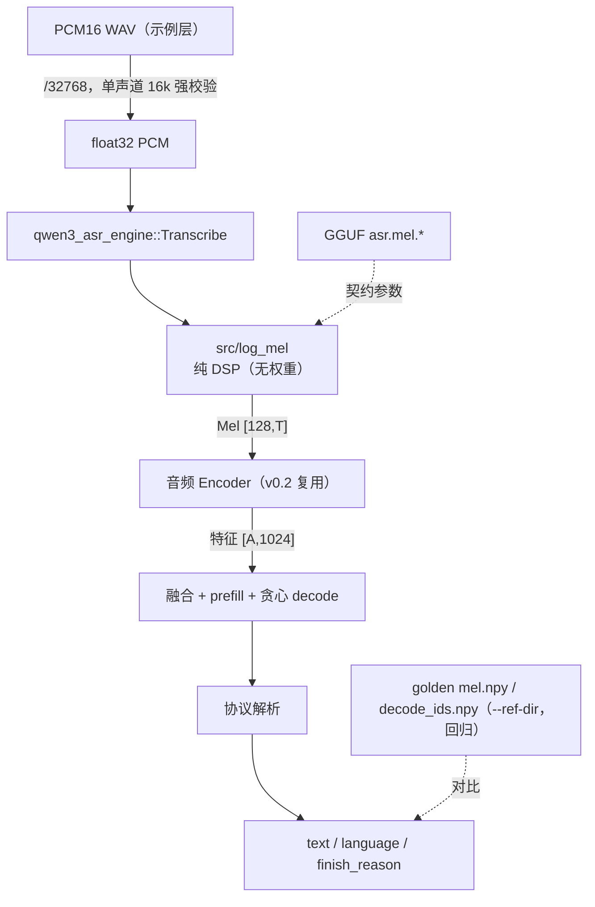

# asr/v0.3 代码分析：从 PCM 到纯 C++ 离线转写

本文解释 asr/v0.3 如何把“输入一段 PCM”变成“C++ 结构化返回的语言与文字”，重点在两个新模块——纯 DSP 的 Log-Mel（`src/log_mel.*`）与最小阻塞 API（`src/asr_engine.*`）；音频塔与 Decoder 计算复用 v0.2，不再重复展开。

- 想先跑起来：看 [README 的 v0.3 快速开始](../../README.md)。
- 想了解 v0.2 音频塔 / Decoder 计算细节：看 [v0.2 代码分析](code_analysis_asr-v0.2.md)。
- 想了解交付范围与验收历史：看 [版本规划](design_asr.md)（§4 为 v0.3 规划，§4.7 为实施记录）。

## 0. 版本定位与整体数据流

v0.2 证明的事：给定参考 Mel，C++ 能独立完成音频编码与文本解码。v0.3 把输入起点再往前推一段，砍掉 Python 运行时依赖：**输入 PCM，C++ 自己算 Log-Mel**，并第一次给出面向调用方的结构化 API（`language` / `text` / 完成原因独立字段）。



长度链仍由一个数推导，v0.3 新增了最上游的一段：

| 记号 | 含义 | 计算方式 | 实测案例（1.9s 语音） |
| --- | --- | --- | --- |
| N | 采样数 | 输入 | 30400 |
| T | 有效 Mel 帧数 | `floor(N/hop)`（STFT 产 T+1 帧丢尾帧） | 190 |
| A | 音频位置数 | `13*floor(T/100)+ceil((T%100)/8)` | 25 |
| S | prefill 长度 | Prompt 模板 + A 个 `<\|audio_pad\|>` | 40 |
| G | 生成 token 数 | 贪心到 EOS 集合 | 8 |

## 1. Log-Mel（src/log_mel.*）：逐点对齐 WhisperFeatureExtractor

黄金参考是本模型官方预处理器（`transformers 4.57.6` 的 `WhisperFeatureExtractor`，实际走 torch 路径）。实现上“剥离移植 whisper.cpp 纯 DSP”只取其 FFT 骨架（`fft()/dft()` 递归 Cooley-Tukey，改 double 精度），filterbank 与归一化按官方公式自实现：

1. **filterbank**：Slaney mel 刻度（`3f/200` 线性段 + `15+27·ln(f/1000)/ln(6.4)` 对数段）+ 面积归一化（`enorm=2/(f_{j+2}-f_j)`），fmin=0、fmax=`sampling_rate//2`；已验证与 `mel_filter_bank(norm="slaney", mel_scale="slaney")` 逐系数相同。系数按官方语义量化 f32。
2. **STFT**：反射填充 `n_fft/2`（居中）；周期 Hann（`0.5*(1-cos(2πi/N))`）;帧 `t` 覆盖填充后序列 `[t*hop, t*hop+n_fft)`；共 `1+floor(N/hop)` 帧。
3. **功率谱与 mel**：`|X|^2` 后乘 filterbank（f32 语义、double 累加），`clamp(1e-10)` 再 `log10`。
4. **尾帧与归一化**：丢弃最后一帧（对应官方 `stft[...,:-1]` 与 attention mask 裁剪），`max(·,max-8)`、`(·+4)/4` 全程 f32。

参数不硬编码：`qwen3_asr_engine` 从 GGUF `asr.mel.*`（`src/model.cpp` 读取，v0.1 转换时已写入）填充 `qwen3_asr_mel_hparams`。结构体缺省值即契约缺省（16k/400/160/128/right），便于脱离模型做单元测试。

**与官方唯一的实质数值差异是 FFT 实现**：官方 pocketfft 在 f32 上累积，本实现 double 计算后在官方的量化点（窗积、功率谱、mel 积累）量化 f32。实测 vs golden：`max_abs = 2.13e-5`、`RMSE = 6.17e-7`。Mel 是音频链路第一道关口，验收后接音频塔。

## 2. 最小阻塞 API（src/asr_engine.*）

调用形态：

```cpp
qwen3_asr_engine engine;
engine.Init(config);                      // 或 InitFromJsonFile(asr_conf_v03.json)
qwen3_asr_request  req{pcm, n, 16000, /*context*/ "", /*language*/ "", /*max_gen*/ 0};
qwen3_asr_response r = engine.Transcribe(req);
// r.text / r.language / r.finish_reason；want_debug=true 时附 mel/T/A/S/gen_ids/raw
```

`Transcribe` 内部五步，每步失败都带明确原因返回：

1. **校验**（在全部计算之前）：空输入、采样率 ≠ `asr.mel.sampling_rate`、超过 `max_audio_seconds`（8s ⇔ A≤104 单窗约束）、NaN/Inf、容量不足（`S+1 > n_ctx`）。错误显式返回，不改标签、不静默截断。
2. **Log-Mel + 音频 Encoder**：音频塔每请求只跑一次，生成阶段复用融合结果。
3. **Prompt / 融合**：模板与 v0.2 完全一致（auto / `language X<asr_text>` 两种）；`audio_pad` 位置替换为音频特征，数量自校验（≠A 即内部错误）。
4. **贪心 decode**：入口 `kv.n_past=0`（每请求重置，重复调用不串 KV）；停止条件依次为 EOS 集合（`asr.eos_token_ids`）、`max_gen`（`finish=length`）、KV 耗尽（`finish=context_full`）。
5. **协议解析**：按 `<asr_text>` token 位置把生成序列切成协议头/正文；协议头 `language X` 解析为独立 `language` 字段；正文 `text` 不含任何 special token 字面量。

与前序版本的分工：`graph.*`/`kv_cache.*`/`tokenizer.*` 原样复用；`audio_encoder.*` 原样复用；本版只新增上游 DSP 与下游编排，不改 Decoder 计算图。

## 3. 示例（examples/asr/api_test/asr_transcribe_v03.cpp）

三种模式共用一个入口：

- **默认转写**：读 WAV（RIFF/fmt/data 逐 chunk 解析，只接受非压缩 PCM、16-bit、后续由引擎校验单声道 16 kHz）→ `/32768` → `Transcribe` 两次，第二次逐 token 对比第一次（KV 重置验证）。
- **`--ref-dir` 对齐**：输入 golden `pcm.npy`，开启 `want_debug`，对比引擎内部 Log-Mel vs `mel.npy`（阈值 `max_abs<1e-4`、`rmse<1e-5`，远高于实测 2.1e-5/6.2e-7 留裕量）与生成 token vs `decode_ids.npy`。
- **`--check-errors`**：空输入 / 44.1 kHz / 超 8 秒 / NaN 四次调用，逐一断言被拒绝且错误信息非空。

## 4. 验收与回归口径

| 项 | 结果 |
| --- | --- |
| Log-Mel vs golden（auto/lang 同输入） | n=24320，`max_abs=2.13e-5`，`RMSE=6.17e-7` |
| 端到端生成 token vs golden | auto 8/8、lang 5/5 完全一致；文本 `今天天气怎么样？` |
| 重复调用 | 二次调用 text/language/gen_ids 完全一致 |
| 边界 | 8.0s（A=104）通过；静音 → `language None` + 空正文；非 hop 整数倍正常 |
| 错误路径 | 空/错采样率/超长/NaN/立体声 WAV 均显式拒绝 |
| v0.2 回归 | `asr_align_v02` auto/lang 均 PASS |
| LLM 回归 | 四类示例（thinking×stream×blocking）各 3 用例运行通过，输出文本/工具调用正常 |
| 缺口 | 英文/数字/标点仅合成与单正样本覆盖，质量回归按规划属 v1.0 |
