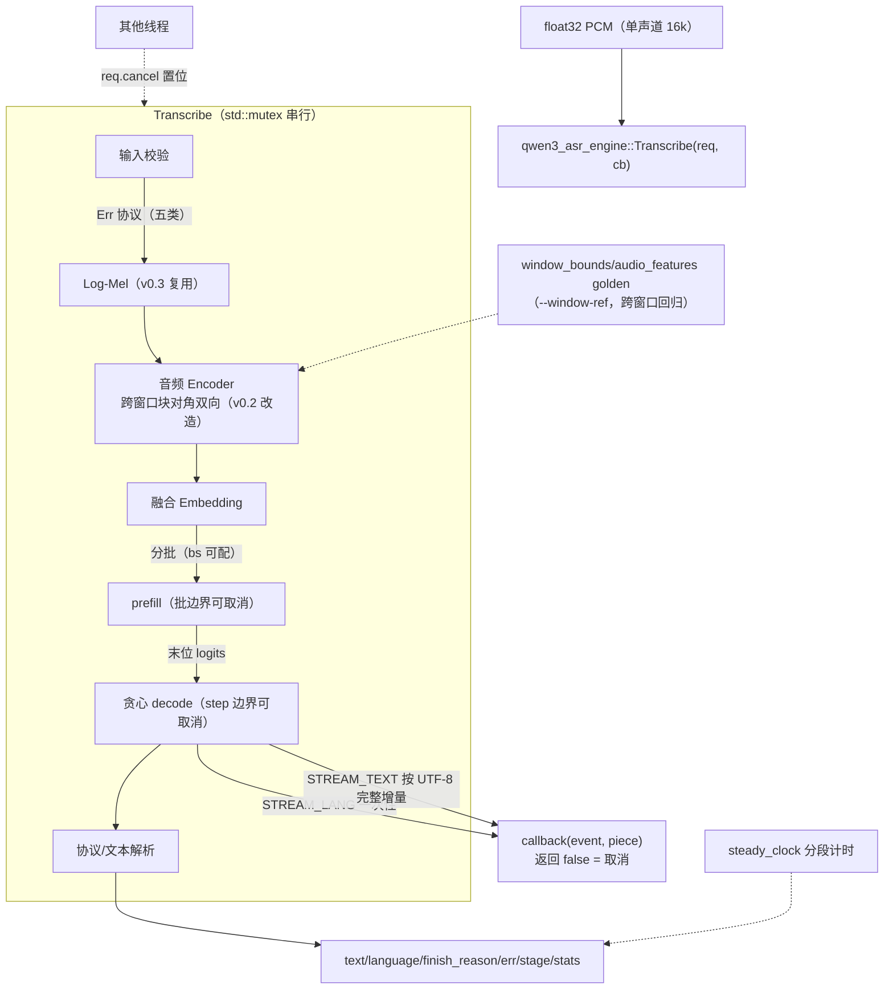
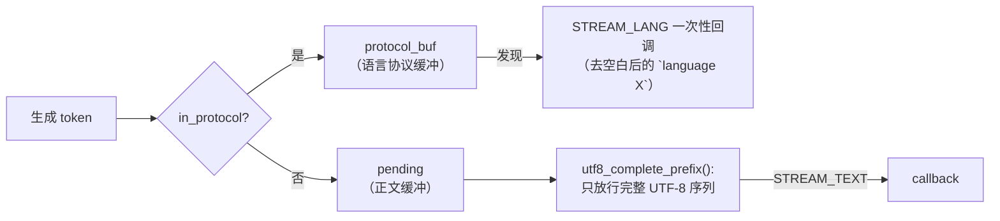

# asr/v0.4 代码分析：完整离线 API、文本流式与跨窗口较长音频

本文解释 asr/v0.4 如何把 v0.3 的“最小阻塞闭环”完善为方便应用集成的接口：文本流式回调、取消机制、错误协议、分批 prefill、跨窗口（>104 音频位置）编码，以及贯穿全程的性能统计。改动集中在 `src/asr_engine.*`（API 与编排）和 `src/audio_encoder.cpp`（跨窗口注意力）；Log-Mel、Decoder 计算图、KV cache、tokenizer 全部原样复用，本文不再重复。

- 想先跑起来：看 [README 的 v0.4 快速开始](../../README.md)。
- 想了解 v0.3 的 Log-Mel 与首版 API：看 [v0.3 代码分析](code_analysis_asr-v0.3.md)。
- 想了解 v0.2 音频塔 / Decoder 计算细节：看 [v0.2 代码分析](code_analysis_asr-v0.2.md)。
- 想了解交付范围与验收历史：看 [版本规划](design_asr.md)（§5 为 v0.4 规划，§5.6/§5.7 为实施记录）。

## 0. 版本定位与整体数据流

v0.3 证明的事：输入 PCM，C++ 能独立产出一对 `language`/`text`。v0.4 回答的是接入问题——应用怎么**边生成边显示**、怎么**中途放弃**、怎么**程序化地区分失败原因**、怎么**知道慢在哪**，以及最长能喂多少音频。



与 v0.3 相比数据通路只有一个实质变化：音频 Transformer 的注意力从“全局双向”变成“官方 cu_seqlens 语义的块对角双向”；其余新增全部在**编排层**（回调、取消、批切分、计时），不改任何算子的数学。

v0.3 的五个记号全部沿用（N/T/A/S/G），并新增窗口维：

| 记号 | 含义 | 计算方式 | 实测案例 |
| --- | --- | --- | --- |
| T | 有效 Mel 帧数 | `floor(N/hop)` | 20s → 2000 |
| A | 音频位置数 | `13*floor(T/100)+ceil((T%100)/8)` | 2000 → 260 |
| W | 注意力窗口数 | 逐块累加凑满 104 关窗（[官方语义](#2-跨窗口音频编码)） | 260 → 3（[0,104,208,260]） |
| S | prefill 长度 | Prompt 模板 + A 个 `<\|audio_pad\|>` | 260 → 275 |
| B | prefill 批数 | `ceil(S/bs)`（bs=128 时 3 批） | 275 → 3 |

## 1. API 面：请求、响应与线程模型

### 1.1 请求与配置（[asr_engine.h](../../src/asr_engine.h#L55-L83)）

`qwen3_asr_request` 在 v0.3 五个字段之外新增三个：

| 字段 | 类型 | 语义 |
| --- | --- | --- |
| `cancel` | `std::atomic<bool>*` | 其他线程置位表示取消；`nullptr` = 不可取消。用原子指针而非句柄/ID：调用方零成本创建，引擎边界检查只在安全点发生 |
| `prefill_batch_size` | `int32_t` | 覆盖引擎配置的批大小；0 = 用配置值 |
| （第 2 参）`callback` | [`qwen3_asr_stream_callback`](../../src/asr_engine.h#L84-L93) | 传入即流式；省略 = v0.3 阻塞行为逐字节不变 |

引擎配置新增 `prefill_batch_size`（默认 128），`max_audio_seconds` 默认从 8 放宽到 **30**（跨窗口落地后不再受单窗 A≤104 约束）。

### 1.2 响应：错误协议与阶段（[asr_engine.h](../../src/asr_engine.h#L114-L175)）

v0.3 只有 `error` 字符串。v0.4 把失败原因拆成可程序分支的枚举，同时保留人读文本：

- `resp.err`：`NONE / NOT_INIT / BAD_INPUT / AUDIO_TOO_LONG / WINDOW_FULL / CONTEXT_INSUFFICIENT / INTERNAL`。`WINDOW_FULL` 保留定义但当前路径不触发（见 §7），供未来非重叠逐段策略区分“音频窗口配额耗尽”与“KV 放不下”。
- `resp.stage`：请求结束（无论成败）时所处的阶段 `INPUT/PREPROC/ENCODER/PREFILL/DECODE/DONE`。取消时它是关键信息——“放弃时走到哪了”；正常结束为 `DONE`。
- `resp.finish_reason` 新增 `CANCELLED`；取消**不是错误**：`ok=true`、`err=NONE`、`error` 为空，`text` 为已回调的部分正文。调用方三种结局（EOS/LENGTH/CONTEXT_FULL/CANCELLED）+ 失败（ok=false）完全正交。

### 1.3 串行与重复调用（[asr_engine.cpp](../../src/asr_engine.cpp#L122-L167)）

- `std::mutex` 串行化 `Init`/`Transcribe`：并发调用**排队逐个执行**而非报错，与 LLM 侧 `Frostfall::InferenceEngine` 的做法一致；
- 重复 `Init` 幂等（返回 true，保持首份模型，不重复分配 1.8 GB 权重缓冲）；
- 回调约束写进头文件注释：callback 只在推理线程内同步调用，回调内不得再进入本引擎任何接口（重入即死锁）；`callback` 返回 false 是**调用方取消**的第二个入口，与置位 `cancel` 等价。

## 2. 跨窗口音频编码

这是本版唯一触碰计算语义的改动，落在 [audio_encoder.cpp](../../src/audio_encoder.cpp#L194-L218)。

### 2.1 参考语义固定：官方 `get_audio_cu_seqlens`

验收前置问题是“跨窗口参考以谁为准”（[架构文档 §5.5](../qwen_model/Qwen3-ASR-0.6B_Model_Architecture_And_Configs.md) 记录过后端分歧：varlen 路径窗口隔离、eager 路径不消费 `cu_seqlens`）。v0.4 固定的答案：**以 `cu_seqlens` 定义的 varlen 分块为准**，依据是 transformers `models/qwen3_asr/modeling_qwen3_asr.py` 的 `get_audio_cu_seqlens` 与 `Qwen3ASRAudioAttention`（非 varlen 后端按 `cu_seqlens` 切段逐段注意力，即块对角语义）；eager 全局双向是缺陷不是语义。

边界构造（官方原文的整数版）：

```text
window_aftercnn = max(各 CNN 块有效位置数) × (n_window_infer / chunk)   // 13×8 = 104
逐 CNN 块累加 cur += alen；cur ≥ 104 时关窗（边界=累计和），尾块收尾
```

两个容易踩的实现细节（Python 与 C++ 各踩一次，见 [window_boundaries](../../src/audio_encoder.cpp#L194-L212)）：

1. 边界是**累计和**而非窗口长——直接 append `cur` 会得到 [0,104,104,156] 这类错误序列，必须 `bounds.push_back(bounds.back()+cur)`；
2. `(len-1)//2` 的地板除在 `len%100==0` 时以负数参与，C++ 截断除法与 Python/torch 不一致（复现官方公式时需严格对齐，这正是 [参考导出脚本](../../scripts/asr/export_asr_window_reference.py#L120-L129) 单独留 `per_chunk_len` 的原因）。

### 2.2 C++ 实现：块对角 mask + 单窗口零改变

- [window_boundaries](../../src/audio_encoder.cpp#L194-L212)：如上构造边界，末值 `bounds.back()==A` 由调用方校验（拼块数与边界数不符即内部错误，不静默吞）；
- [run_transformer_stage](../../src/audio_encoder.cpp#L222-L345)：`bounds.size()==2`（单窗口）时**不建 mask 张量**，完全走 v0.3 的 `soft_max_ext(kq, nullptr, ...)` 路径——A≤104 的输入与旧版逐位一致不是近似而是同一份图；多窗口时构造 `[A,A]` F32 mask（同窗口 0、跨窗口 `-inf`，[构造处](../../src/audio_encoder.cpp#L244-L260)），经 `ggml_soft_max_ext` 的 mask 广播作用于每层 `kq` 前 two 维。mask 张量用 `ggml_set_input` 挂输入，每层复用同一张量，不重复拷贝；
- [run_cnn_batches](../../src/audio_encoder.cpp#L363-L384)：CNN 阶段按 `chunk_capacity` 分批构图（各块完全独立，切片不改数值），批边界查询 `on_cancel`。默认 `-1` 不分批——长音频主动分批只影响峰值内存，不影响结果。

### 2.3 与官方 varlen 的等价性验证

参考侧无法运行 FlashAttention（CPU 环境），[export_asr_window_reference.py](../../scripts/asr/export_asr_window_reference.py#L102-L190) 在 eager SDPA 上显式构造同款块对角 `attn_mask` 复现 varlen 语义，导出 20s golden（T=2000，A=260，边界 [0,104,208,260]）。C++ 对齐结果（容差沿用 v0.2 的 `kAudioRmseTol=0.20`）：

| 分段 | RMSE |
| --- | --- |
| conv_out（CNN+位置编码后） | 2.7e-4 |
| 18 层逐层 hidden（最深层） | 8.1e-4 |
| 最终 features [A,1024] | 6.2e-5 |

### 2.4 上限链路

窗口内不设上限后，真正的约束链是：`max_audio_seconds`（默认 30，入口校验，超即 `AUDIO_TOO_LONG`）→ A 仍由 `(T,S)` 公式自然增长 → `S+1 ≤ n_ctx`（失败即 `CONTEXT_INSUFFICIENT`，如 30s 音频 S=405 vs n_ctx=4096 可过、n_ctx=64 必拒）。30 秒端到端实测 A=390/S=405、两次调用一致、阻塞与流式一致；更长的输入受 KV 容量与 §5.5 的“不承诺无界长音频”约束。

## 3. 分批 prefill（[asr_engine.cpp](../../src/asr_engine.cpp#L419-L450)）

把 v0.3 的一次 `eval_token_graph(fused, S, n_past=0)` 改成循环：

```text
for p0 = 0; p0 < S; p0 += bs:
    eval_token_graph(fused[p0:], nb=min(bs, S-p0), n_past=kv_.n_past)
```

正确性依赖三件事同步顺延，缺一即数值漂移：

1. **KV 写入位置**：`eval_token_graph` 用 `kv_.n_past` 起写并回写 `n_past += n_tokens`，批间自动顺延；
2. **位置向量**：`pos[i] = n_past + i`，每批从新 `n_past` 重算（[实现](../../src/asr_engine.cpp#L220-L232)）；
3. **因果 mask**：mask 尺寸 `[n_tokens, n_past+n_tokens]`，查询位只屏蔽 `kv > n_past+q`——批内互见、对全部历史可见。

非末批的 logits 被丢弃（只末批写 `logits`）；因果语义下末批末位 logits 与单批完全一致——实测 S=40/bs=8、S=275/bs=128、S=43/bs=8 的 `gen_ids` 均与单批逐 token 一致。峰值收益来自 gallocr 按**当批**图分配计算缓冲：S=405/bs=128 峰值 6.94 MB（单批约 20 MB 量级），bs=8 时 0.61 MB。每批边界同时是取消检查点。

## 4. 文本流式（[asr_engine.cpp](../../src/asr_engine.cpp#L452-L530)）

流式的全部难点在**边界**：token ≠ 字符，协议头不是正文。实现用三个缓冲加一个过滤器：



- **协议段**：`<asr_text>` 之前的生成 token 全部进 `protocol_buf` 不外泄；`find("<asr_text>")` 命中后把头去首尾空白后解析出语言值并一次性回调 `STREAM_LANG`。指定语言模式协议在 prompt 预置，`in_protocol` 初始即 false，生成直接进正文（首个 token 可能仍是 `<asr_text>`，吞掉）；
- **UTF-8 边界**：[utf8_len/utf8_complete_prefix](../../src/asr_engine.cpp#L100-L116) 校验首字节续长度与 `0b10xxxxxx` 续字节，把尾部不完整序列留在 `pending` 等下一个 token。回调只发生在完整序列边界，调用方拿到的 `piece` 永远是可安全渲染的文本；
- **一致性来源**：`emitted`（已回调）与解析版 `text` 在正常结束时逐字节一致，因为增量顺序就是贪心生成顺序。示例程序把这条不变量作为验收断言（流式 text == 阻塞 text，中文 24 字节、`[今天][天气][怎么样][？]` 四增量案例）。

阻塞模式（`callback=nullptr`）不进任何缓冲逻辑，走 v0.3 解析路径——一条 if 分支隔离新旧两态，是 API 向后兼容的关键。

## 5. 取消与统计

### 5.1 取消检查点

不承诺打断单个 ggml 算子（§5.2 规划原文），检查点取在自然的批/步边界：CNN 分块批内（`on_cancel` 传入编码器）、prefill 每批前后、decode 每 step 前。两个内聚设计：

- [asr_cancel_return](../../src/asr_engine.cpp#L254-L268)：取消路径统一收口，填 `ok=true` + `CANCELLED` + `stage` + 已知统计（不写 error——取消不是错误）；
- `callback` 返回 false 与置位 `cancel` 汇入同一状态机，示例里两个入口分别演示（回调取消见 §6）。

取消时 `text` 的取值规则：流式模式下只取 `emitted`（已确认回调的部分），`pending` 中未 flush 的尾段丢弃——保证“上层显示的字”与“引擎返回的字”永远一致；取消发生在 prefill/encoder 时 `text` 为空（无可给正文）。

### 5.2 统计的计时边界（[qwen3_asr_stats](../../src/asr_engine.h#L161-L175)）

wall-clock `steady_clock`，分段与 stage 一致：`t_preproc`（Log-Mel）/ `t_encoder`（音频塔，CNN+Transformer+投影整体）/ `t_prefill`（批累计）/ `t_decode`（step 累计）/ `t_total`。两个刻意区分的量：

| 指标 | 定义 | 实测（1.9s 语音，auto 模式） |
| --- | --- | --- |
| `t_first_model_token` | prefill 末位产出的**第 1 个生成 token** 时刻 | 1.79 s |
| `t_first_visible_text` | **第 1 个正文增量**回调时刻；语言协议 token **不计入** | 2.16 s |

§5.4 验收项“不把首个语言协议 token 当成首个转写文字”落在这里：`STREAM_LANG` 回调放在语言解析处但不更新 `t_first_text`，只有 `flush_stream` 首次放行正文时才置位。`rtf = t_total / (n_samples/sample_rate)` 为端到端口径（含音频塔与 prefill 的一次性开销），30s 实测 ≈0.70；不含录音等待（附录 B 的提醒适用）。`peak_galloc_bytes` 取各批 `ggml_gallocr_get_buffer_size` 最大值，仅统计 Decoder 图分配器（KV 与权重另计）。

## 6. 示例（[asr_transcribe_v04.cpp](../../examples/asr/api_test/asr_transcribe_v04.cpp)）

一个入口六个演示块（均可独立用于验收）：

| 模块 | 断言 |
| --- | --- |
| 阻塞 #1 + 重复调用 | v0.3 行为回归 |
| 流式 vs 阻塞 | 最终 text 逐字节一致；指定语言模式不出现 LANG 事件 |
| `--prefill-batch N` | 批数正确（S=40/bs=16 → 3 批）；配合 `--cancel-after` 演示 prefill 末位取消 |
| 取消（回调） | 首个 TEXT 回调取消 → `stage=prefill`；第 2 增量后取消 → `stage=decode`；部分正文为已回调前缀 |
| 外部线程取消（>8s 输入） | 50ms 后置位 → 编码器批边界取消 |
| `--check-errors` | 五类错误逐一断言 `err` 枚举；`--re-init` 幂等 |
| `--window-ref` + `--ref-dir` | 跨窗口 golden（边界/conv_out/逐层/features）与 v0.3 gen_ids golden |

`--window-ref` 走 [check_window_ref](../../examples/asr/api_test/asr_transcribe_v04.cpp#L224)：不经 `Transcribe`，直接加载 GGUF 调 `qwen3_asr_encode_audio` 对齐音频塔——这是刻意保留的“音频塔只跟 golden 对”的分层验证入口（同 asr_align_v02 思路）。窗口边界在示例侧按官方公式独立重算再与 `window_bounds.npy` 逐值比对，等价于对引擎 `window_boundaries` 的交叉验证。

## 7. 已知边界与差异（不改变承诺）

- `WINDOW_FULL` 定义保留、当前不触发：A>104 走块对角掩码单次编码，超载由 `CONTEXT_INSUFFICIENT` 拦截。如未来改回非重叠逐段策略，用该码区分语义；
- `run_cnn_batches` 的 `chunk_capacity` 默认不分批；启用只影响内存峰值不影响数值；
- 取消粒度受算子大小限制：未分批配置下单个大 CNN 图或大 prefill 批完成前无法中断（规划 §5.2 第 2 条已声明）；
- 流式回调发生在推理线程内（同步）；跨线程投递到 UI 是调用方责任；
- 跨窗口参考后端是“显式 mask 的 eager SDPA 对 varlen 语义的复现”，非 FA 本尊；更换官方源码版本后需按 [design §5.6](design_asr.md) 重新核验。

## 8. 验收与回归口径

| 项 | 结果 |
| --- | --- |
| 跨窗口 golden（20s, A=260, W=3） | 边界逐值一致；conv_out/逐层/features RMSE 2.7e-4 / 8.1e-4 / 6.2e-5（容差 0.20） |
| 单窗口不变性 | v0.3 回归：auto 8/8、lang 5/5 gen_ids 一致；Log-Mel 不变 |
| 30s 端到端 | T=3000/A=390/S=405 入 KV；RTF≈0.70；两次调用、阻塞↔流式一致 |
| 一致性 | 同输入阻塞 vs 流式 text 逐字节一致（含指定语言模式） |
| 取消 | 回调/置位两入口;prefill 与 decode 两个取消点 stage 语义正确；部分正文=已回调前缀 |
| 错误协议 | 空/NaN/错采样率→BAD_INPUT；超 30s→AUDIO_TOO_LONG；n_ctx=64→CONTEXT_INSUFFICIENT |
| 分批 prefill | S=405/bs=128 峰值 6.94 MB；S=40/bs=8、S=43/bs=8、S=275/bs=128 gen_ids 与单批一致 |
| LLM 回归 | 四类示例重新接入构建，各 3 用例通过（STOP/TOOL_CALLS 输出正常） |
| 缺口 | 合成音频质量回归仍属 v1.0；GPU/量化类优化未做（规划 §5.5） |
